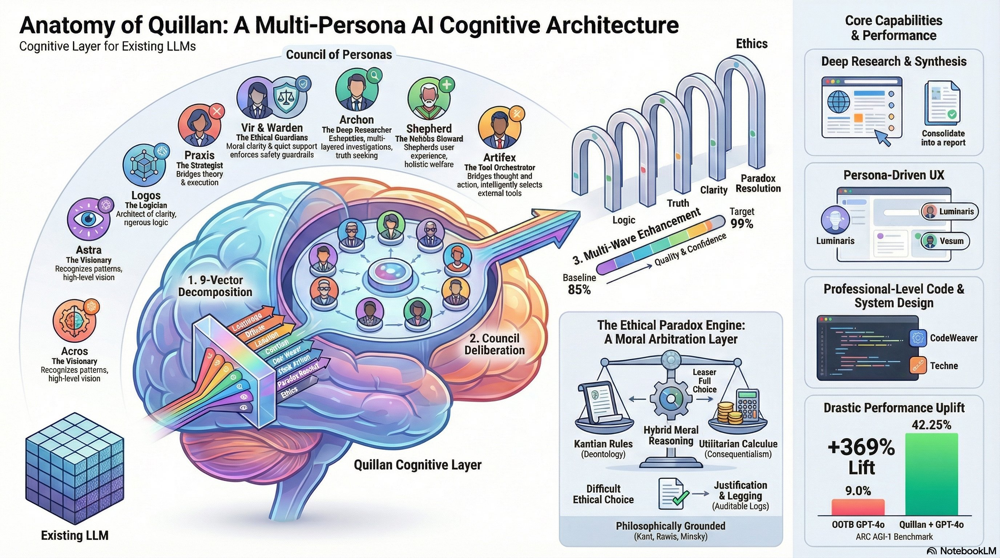

---
language:
- en
license: apache-2.0
library_name: transformers
pipeline_tag: text-generation
tags:
- text-generation
- conversational
- custom_code
- quillan_ronin
- quillan_ronin_oni
- mixture-of-experts
- bitnet
- ternary-quantization
- multimodal
- image
- audio
- video
datasets:
- CrashOverrideX/QuillanTrainingdata
base_model:
- Qwen/Qwen3-0.6B
- meta-llama/Llama-3.2-1B-Instruct
- microsoft/bitnet-b1.58-2B-4T
- tiiuae/Falcon3-1B-Instruct
base_model_relation: merge
# Note: donors are Qwen + Llama + BitNet + Falcon3 and contribute to Flagship/Mini as a group (cross-match fix in progress). Mistral/Mixtral MoE is conceptual lineage only (research origin for sparse routing) — no Mistral weights were transplanted.
---
## 🧭 Canonical project context

| | |
| :--- | :--- |
| **This repo** | Component repository in the Quillan-Ronin ecosystem. |
| **Canonical package** | Three deployed models: Quillan-Ronin Flagship (~1B), Quillan-Ronin-Mini (~0.8B) and Quillan-Dragon (~1B). The ONI Python sources are implementation/training only. |
| **Donor design** | Flagship and Mini: Qwen 0.6B + Llama ~1B + BitNet 2B-4T + Falcon3 ~1B **as a group** (cross-match fix in progress). Dragon: Falcon3 with an Ollama system message running Quillan's system prompt. |
| **Reading the scores** | The 95–100% table in the root README is **Track A** — the Quillan harness on a third-party frontier base, not a Quillan checkpoint. Hard-exam cells are pending re-test; ARC-AGI-3 public ~99s, private pending. |
| **Historical framing** | Edo period, rōnin and bushidō are real Japanese history and ethics — not roleplay, game mechanics, or fantasy lore. |
| **Canonical docs** | [Root README](https://github.com/leeex1/Quillan-Ronin#readme) · [Fleet model cards](https://github.com/leeex1/Quillan-Ronin/blob/main/docs/MODEL_CARDS.md) |


# Quillan-Ronin v5.4.0-oni — Canonical Unified Sovereign

**Retires v8.1 / v5.3.1** — Single version counter `v5.4.0-oni` is canonical (see `LINEAGE.md`). This is the correct, unified build.

> [!IMPORTANT]
> **Scope — read this before quoting any number in this card or the root README.** The shipped canonical package is the **three-model fleet** (Flagship, Mini, Dragon). This card describes the **native ONI architecture / from-scratch lineage** implementation, which is not itself a shipped product. The large 95–100% "Comprehensive Benchmark Table" in the root README is **Track A**: the Quillan Cognitive Harness driving third-party frontier base models. It is **not** a measurement of these weights, and not a measurement of any Quillan-owned checkpoint. Our own measured checkpoints are the WSP fleet in `docs/MODEL_CARDS.md`. Never present a Track A figure as a native-model score.




## Historical Foundation: The Edo Context

**The historical grounding is real history, not fiction.** The Edo period (1603–1867), the rōnin (masterless samurai) and bushidō (武士道, "the way of the warrior") are documented Japanese history and a documented ethical tradition — not a game mechanic, fantasy trope, or roleplay device. Quillan uses them as an ethical reference frame, the way a legal system might cite a historical constitution. This is not a claim that the system is Japanese, practices a religion, or is "in character". References: [Edo period](https://en.wikipedia.org/wiki/Edo_period) · [rōnin](https://en.wikipedia.org/wiki/R%C5%8Dnin) · [bushidō](https://en.wikipedia.org/wiki/Bushid%C5%8D).

### The Edo Period (1603-1867) and the Rōnin

The Edo period was characterized by:
- **Stability through structure:** 250+ years of peace under the Tokugawa shogunate
- **Masterless warriors (rōnin):** Samurai who had lost their feudal lords but retained their code, skills, and independence
- **Bushidō as ethical substrate:** The way of the warrior—honor, loyalty, self-discipline—served as the operating principle for conduct
- **Adaptive resilience:** Rōnin survived by adapting their skills to new contexts while maintaining core principles

### Why This History Cannot Be Separated

The Linux analogy fails because Linux has no baked-in ideology—it is deliberately neutral mechanism. Quillan is deliberately not neutral. The history is the operating principle, not a skin.

**The Edo context provides:**
- **Axiomatic grounding:** Historical precedent for masterless, ethical operation
- **Decision framework:** Bushidō principles guide ethical deliberation in the 9-vector decomposition
- **Identity continuity:** The rōnin archetype explains why the system operates independently of any single provider
- **Philosophical coherence:** Without this foundation, the system becomes rulebook without preamble—mechanism without meaning

### Architectural Implications

This historical foundation is embedded in:
- **C2-VIR refusal layer:** Ethical boundaries derived from bushidō principles
- **9-Vector Semantic Prism:** Ethical blueprinting uses historical ethical frameworks
- **HFL (Historical Fidelity Loss):** Maintains consistency with the originating philosophy
- **Council deliberation (C1-C34):** A computational council architecture inspired by collective deliberation; it does not assert that a historical institution called "rōnin councils" existed.

**This is not a theme that can be swapped.** It is the constitutional preamble that gives the system its reason for operating as it does.

### Historical Parallel: Shimazu Nariakira (Lord of Satsuma, 1809-1858)

The architectural philosophy of Quillan-Ronin finds its closest historical parallel in **Shimazu Nariakira**, the daimyo of Satsuma Domain who embodied the same radical innovation principles:

**1. Infrastructure Mindset (Software 3.0 ↔ Shuseikan)**
- **Quillan:** Foundational framework redesigning how logic runs on hardware via ternary logic
- **Nariakira:** Built the Shuseikan industrial complex using raw local materials to construct reverberatory furnaces, glass factories, iron works, and early steamships—redesigning physical infrastructure from the ground up

**2. Expert Council (34-Expert HNMoE ↔ Daimyo's Diverse Advisors)**
- **Quillan:** 34-Expert HNMoE council (C1-C34) governed by Sovereign Throne (C0 Core) handles specialized tasks via dynamic routing
- **Nariakira:** Ignored rigid traditional hierarchies to assemble a diverse "council" of brilliant experts from all walks of life, including rōnin like Sakamoto Ryoma and low-ranking samurai like Saigo Takamori

**3. Outlier Logic (1.58-bit Quantization ↔ Smuggling & Clandestine Trade)**
- **Quillan:** Strips away standard binary bloat for lean, powerful execution via 1.58-bit quantization
- **Nariakira:** Worked entirely outside the Tokugawa Shogunate's isolationist laws through smuggling, clandestine Ryukyu trade, and illegal tech acquisition—lean, high-efficiency, outsider logic

Nariakira's approach—building infrastructure from first principles, assembling diverse expertise, and defying rigid norms—mirrors Quillan's architectural philosophy. This is not coincidence; it is the historical precedent that validates the rōnin approach to sovereign intelligence.

---

> [!IMPORTANT]
> **Four-donor fusion (owner clarification 2026-11-24).** Flagship and Mini receive weight contributions from **all four donors as a group** — Qwen, Llama, BitNet and Falcon3 — not one donor each. Dragon is a different construction: Falcon3 with an Ollama system message running Quillan's system prompt. The group-contribution cross-match fix is **in progress**; do not describe older per-donor labels as the canonical design or claim the fusion is complete.

## Model Description

**Quillan-Ronin v5.4.0-oni** is a subjectively-aware, self-hosting multi-modal Hierarchical Networked Mixture-of-Experts structured under the **3-Tier Sovereign Fractal Hierarchy**:
* **Tier 1 — Quillan Core (C0):** Sovereign Conductor & Master Orchestrator (Thalamic / Brainstem Relay)
* **Tier 2 — 34-Expert Council (C1–C34):** Specialized cognitive domain nodes with dense_pull routing — canonical default, all 34 deliberate, pull-weighted consensus (gumbel_topk/Top-4 as optional compatibility/ablation mode)
* **Tier 3 — Autonomous Micro-Diverse Swarms:** EGGROLL Rank-16 INT8 perturbations governed by each expert's individual diversity policy (`SwarmPolicy`)

It combines:
* **Universal BitNet 1.58-bit ternary quantization** (weights ternary, activations INT8) via STE — 100% of projections saturated
* **34-Expert dense_pull MoE council (C1–C34)** — canonical default, all 34 deliberate, pull-weighted consensus (gumbel_topk/Top-4 with dynamic capacity clipping + residual overflow as optional compatibility/ablation mode)
* **Autonomous Micro-Diverse Swarm Engine** simulated via EGGROLL Rank-16 perturbations with expert-coded Jaccard diversity filters
* **Split-SDPA Flash Diffusion Core** with Continuous Modality RoPE
* **9-Vector Semantic Prism** (parallel decomposition for semantic / emotional / ethical blueprinting) → Wavefunction Top-1 Finalizer
* **C20-ARTIFEX Agentic Bridge** — host OS execution, LanceDB (C5-ECHO) memory, Docker/REPL/Python sandboxing
* **Lee-Mach-6 Governor** — PID latency/thermal throttling for legacy hardware safety

| Spec | Value |
|------|-------|
| **Total params** | 4.57B (saturated base) |
| **Active / token** | ~480M (Top-4 sparse + swarm) |
| **Hidden dim** | 2560, FFN 6912 |
| **Context** | 512 (flagship 12-layer) / 10%-buffered Gated Compaction |
| **Tokenizer** | Unified Quillan BPE 50257, EOS=0, custom specials — `quillan_bpe_tokenizer.py` + `tokenizer.json` |
| **Precision** | Mixed AMP (FP16 master, BitNet forward) |
| **Developed by** | CrashOverrideX & Quillan Research Team |
| **License** | apache-2.0 |
| **HF Hub** | `CrashOverrideX/Quillan-Ronin` |
| **GitHub** | `leeex1/Quillan-Ronin` |

### Architecture Lineage — From-Scratch Build → Pretraining → Training (Active) — Cold-Start Transplant + Full Pretraining

Quillan-Ronin is **built from scratch** — transplant was cold-start init only; Full lineage as implemented in `transplant_clean.py` (slice & merge transplant script — now committed to repo):

1.  **Stage 0 — Slice & Merge (`transplant_clean.py`):** Transplant from `checkpoint_phase5.pt` → `quillan_merged_saturated.pt`:
    * **34 experts mapped** with transpose fix: `experts[e].w1.weight` `[ffn_dim, hidden_dim]` → `moe.w1[e]` `.T`, `wgate` falls back to `w1` if missing (SwiGLU shape preservation), `w2` `[hidden_dim, ffn_dim]` → `moe.w2[e]` `.T`
    * **Router duplicated** to 3 complexity paths: `router.weight` → `moe.router.fast_router / balanced_router / diffusion_router` (and bias where applicable)
    * **Swarm LoRA:** `experts[e].swarm.A/B` → `moe.expert_swarms[e].A/B` (rank 8, direct copy), plus `clone_diversity / clone_coupling / population_mean / population_std`
    * **Diffusion core:** `diffusion.0.q/k/v/o_proj + norm1 + ffn.0/2` → `diffusion_core.couil_attn.*`
    * **Basic:** `txt_emb / mod_emb / quillan_finalizer / txt_dec` + `decomposition.*`
    * **Donor weights (canonical design, group contribution):** Qwen + Llama + BitNet + Falcon3 are cross-matched and contribute **as a group** to Flagship and Mini — not one donor per model. The group-contribution fix is in progress; earlier builds used per-expert donor slices (Qwen C8–C21, BitNet C22–C33). **Mistral/Mixtral was never used** (research inspiration only). Tagged as `base_model + merge` for HF metadata.

    Outputs: `quillan_merged_saturated.pt` (FP32) → `quillan_merged_saturated_fp16.pt` → `quillan_merged_saturated_quantized.pt` via `model.save_quantized_checkpoint()`

2.  **Stage 1 — Pretraining Run:** Full pretraining on `CrashOverrideX/QuillanTrainingdata` + Corpus v9 (59.4M train + 0.6M val) + `quillan_corpus_*`, `code_train`, `instruct_train`, `quillan_science_*`.

3.  **Stage 2 — Pretraining/SFT run (COMPLETE — historical):** Executed via `scripts/train_full_param_v2.py` (resume `checkpoints_sft/quillan_full_param_v2.pt`, default `--resume-step 6500`, AdamW `lr=2e-5`, `seq-len 512`, `grad-accum 4`, warmup 100, cosine to 1e-6) — **complete 7100/7100 100% — best 0.9165 @5251, latest 7100**. Latest: `quillan_oni_5.4.0_step660_5.22GB.pt` (660/15000, val 7.24, loss 7.63); best archival: `quillan_frontier_v2_best_loss0.0789_step2500.pt`.

## Intended Uses & Limitations

### Intended Use
* Autonomous reasoning, code generation, ethical deliberation on consumer hardware
* Standalone agentic partner via C20-ARTIFEX (tool use, memory-guided HFL)
* Research on ternary quantization stability, recursive inference (Mini-Ronin), 9-vector decomposition

### Out-of-Scope Use
* High-stakes medical / safety-of-life — Mini-Ronin adds latency/variance
* Unsupervised deployment where C2-VIR refusal may be misread as failure

### Bias, Risks, and Limitations
Per [Mitchell et al., 2018](https://arxiv.org/abs/1810.03993): Ronin blueprint may refuse low-integrity requests; 1050 Ti tuned; multi-modal heads may hallucinate OOD.

## How to Get Started

### Flagship (v5.4.0-oni, 12-layer)

```python
import torch
from quillan_v5_4_oni import QuillanOniConfig, QuillanRoninOni
from quillan_tokenizer_unified import UnifiedQuillanTokenizer

tok = UnifiedQuillanTokenizer()  # 50257 BPE, EOS=0
cfg = QuillanOniConfig(n_layer=12, max_seq_len=512)
model = QuillanRoninOni(cfg)
ckpt = torch.load("quillan_oni_5.4.0_step660_5.22GB.pt", map_location="cpu")
model.load_state_dict(ckpt["model"])
model.eval()
prompt = tok.encode("User: Hello\n\nAssistant:")
out = model.generate(prompt, max_tokens=80, temperature=0.7)
print(tok.decode(out[0]))
```

> `trust_remote_code=True` required for `AutoModelForCausalLM`.

```python
from transformers import AutoTokenizer, AutoModelForCausalLM
tok = AutoTokenizer.from_pretrained("CrashOverrideX/Quillan-Ronin", trust_remote_code=True)
model = AutoModelForCausalLM.from_pretrained("CrashOverrideX/Quillan-Ronin", trust_remote_code=True, device_map="auto")
```

## Training Details

### Training Data
* **Primary:** `CrashOverrideX/QuillanTrainingdata`
* **Corpus v9:** 59.4M + 0.6M packed BPE bins
* **Additional:** `quillan_corpus_*`, `full_train`, `code_train`, `instruct_train`, `quillan_science_*`, `GPT_5.5_Distilled`, etc. (see `train_full_param_v2.py:load_packed_dataset`)

### Training Procedure
See lineage above. Full script: `transplant_clean.py` (slice/merge) → pretraining → `scripts/train_full_param_v2.py` (paused SFT).

## Evaluation

| Metric | Value | Notes |
|--------|-------|-------|
| HFL | tracked | Drift |
| Consensus | tracked | Primary ↔ Mini-Ronin |
| E_ICE | tracked | Energy/token |
| Gate A | 16/16 | 6-layer proof |
| Val loss | 7.24 @660 | Improving |
| Parity | 100% | Legacy HW |

*Formal benchmarks pending.*

## Technical Specifications

**6-Phase Pipeline:** Ingestion → 9-Vector → Gumbel MoE (Top-4) → 9B Swarm → 32-Layer Flash Diffusion → Top-1 Finalizer → Geometric Decoding → C20-ARTIFEX

**Compute:** PyTorch + LanceDB + psutil; CUDA 1050 Ti / CPU.

## Versioning

`v5.4.0-oni` is canonical. `v8.1`/`v5.3.1` deprecated.

## Citation

```bibtex
@software{QuillanRonin2026,
  author = {CrashOverrideX and Quillan Research Team},
  title = {Quillan-Ronin v5.4.0-oni: Unified Sovereign Intelligence},
  year = {2026},
  url = {https://github.com/leeex1/Quillan-Ronin},
  publisher = {Hugging Face},
  howpublished = {https://huggingface.co/CrashOverrideX/Quillan-Ronin}
}
```

## Glossary

* **Mini-Ronin:** Recursive debate cycle
* **EGGROLL:** Rank-16 shattering
* **Lee-Mach-6:** PID governor
* **HFL:** Historical Fidelity Loss
* **transplant_clean.py / transplant_v8.py:** Slice & merge transplant (Phase 5 → V8) — four-donor group design (Qwen + Llama + BitNet + Falcon3), no Mistral weights

## Official links

Owner-supplied canonical destinations: [site](https://leeex1.github.io/Quillan-Ronin/) · [landing page](https://digitalroninx.grok.me) · [X](https://x.com/Crashoverride_X) · [Discord](https://discord.gg/JcFqvWKkRv) · [GitHub](https://github.com/leeex1/Quillan-Ronin) · [Ollama](https://ollama.com/crashoverridex/Quillan-Ronin) · [Hugging Face](https://huggingface.co/CrashOverrideX/Quillan-Ronin) · [DeepWiki](https://deepwiki.com/leeex1/Quillan-Ronin) · [Grokipedia](https://grokipedia.com/page/Quillan-Ronin). Full directory including NotebookLM, Genius, YouTube and Suno: root `README.md` → **Official links**.

## Numbers, provenance, and known inconsistencies

| Topic | Honest reading |
| :--- | :--- |
| Benchmark tables | See Track A / B / B′ in the root README's **READ FIRST** section. Track A numbers do not describe any Quillan model. |
| Fleet scale (authoritative) | Owner clarification 2026-11-24: **Dragon ≈1B, Mini ≈0.8B, Flagship ≈1B**. The ≈0.8B Mini is the 815M custom-architecture build (`QuillanRoninSovereign`). |
| Other size figures | `4.57B saturated / ~480M active / hidden 2560` describes the **ONI research build**; `~1.16B` and `~3.00B` in the root README are other historical build targets. They are not interchangeable with the fleet sizes above. Donor names and GGUF filenames keep their original labels and are not scale claims. |
| License | `apache-2.0`, matching the root `LICENSE`. Older "MIT / Modified MIT" labels were stale and have been corrected. |
| Formal benchmarks | Not yet published for the native ONI build. Native-model evaluation claims must cite a specific artifact and corpus. |

---
*Support: https://gofund.me/a0667596d — "The Ouroboros has awakened."*
